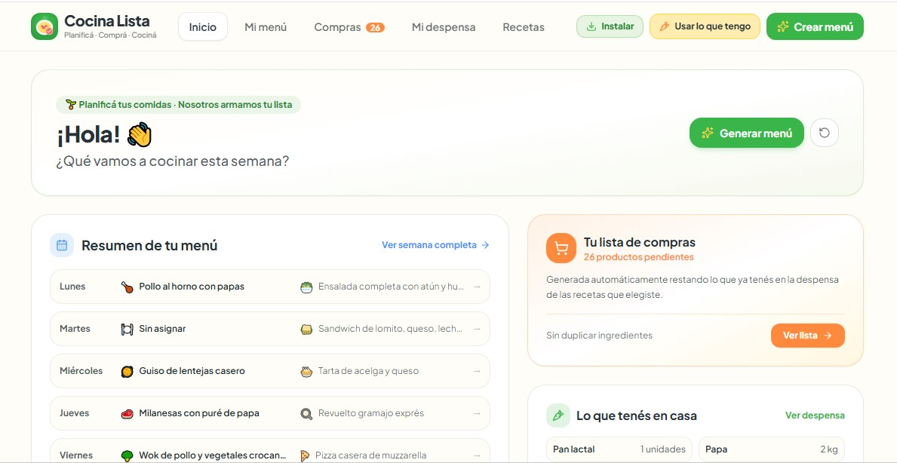

 

  <a href="#español">🇦🇷 Español</a> |
  <a href="#english">🇬🇧 English</a>

# 🍽️ CocinaLista

**Planificador de menús, recetas y listas de compras**

CocinaLista es una aplicación diseñada para simplificar la organización de las comidas diarias. Permite planificar menús, gestionar recetas y preparar listas de compras, ayudando a ahorrar tiempo, organizar las comidas del hogar y facilitar las compras de cada semana.

---

## ✨ Funcionalidades

- 📅 **Planificación de menús:** organizá las comidas y planificá qué cocinar.
- 📖 **Gestión de recetas:** creá y guardá tus propias recetas.
- ✏️ **Edición de recetas:** modificá la información de tus recetas cuando lo necesites.
- 🗑️ **Eliminación de recetas:** mantené tu colección organizada.
- 🛒 **Lista de compras:** organizá los ingredientes que necesitás para preparar tus comidas.
- 🏠 **Organización personal:** reuní en un mismo lugar las herramientas que necesitás para planificar las comidas de tu hogar.

---

## 🎯 Objetivo del proyecto

CocinaLista nace con la idea de convertir la planificación de las comidas en una tarea más sencilla y práctica.

Su objetivo es centralizar la organización de menús, recetas y compras en una herramienta fácil de utilizar, que ayude a simplificar las tareas cotidianas del hogar.

---

## 🛠️ Tecnologías utilizadas

- **[Google AI Studio](https://aistudio.google.com/):** entorno de desarrollo asistido por Inteligencia Artificial, utilizado para crear y mejorar la aplicación.
- **[TypeScript](https://www.typescriptlang.org/):** lenguaje de programación utilizado para desarrollar la lógica de la aplicación.

---

## 💡 Desarrollo del proyecto

CocinaLista fue desarrollada con asistencia de Inteligencia Artificial, utilizando Google AI Studio para generar y perfeccionar funcionalidades, y TypeScript para implementar la aplicación.

El proyecto combina el uso de herramientas de IA con el desarrollo de una solución digital orientada a resolver una necesidad cotidiana: organizar menús, administrar recetas y planificar las compras del hogar.

---

## 🚀 Acceso al proyecto

- 🌐 **Aplicación online:** [Probar CocinaLista](https://cocina-lista.ai.studio/)
- 💻 **Repositorio:** [CocinaLista en GitHub](https://github.com/MarisaS1978/CocinaLista)

---

## 👩‍💻 Sobre el proyecto

CocinaLista es un proyecto personal orientado al desarrollo de herramientas digitales útiles para la vida cotidiana.

Forma parte de mi aprendizaje y práctica en el desarrollo de aplicaciones, el diseño de interfaces y el uso de herramientas de Inteligencia Artificial para crear soluciones digitales.

---

**CocinaLista — Menos tiempo organizando, más tiempo disfrutando.** 🍅🥕

---

# 🍽️ CocinaLista

**Meal Planner, Recipe Manager and Shopping List Organizer**

CocinaLista is an application designed to simplify everyday meal organization. It allows users to plan menus, manage recipes, and create shopping lists, helping save time, organize household meals, and make weekly grocery shopping easier.

---

## ✨ Features

- 📅 **Meal Planning:** organize your meals and plan what to cook.
- 📖 **Recipe Management:** create and save your own recipes.
- ✏️ **Recipe Editing:** update your recipe information whenever needed.
- 🗑️ **Recipe Deletion:** keep your recipe collection organized.
- 🛒 **Shopping List:** organize the ingredients you need to prepare your meals.
- 🏠 **Personal Organization:** bring together the tools you need to plan your household meals in one place.

---

## 🎯 Project Goal

CocinaLista was created with the idea of making meal planning a simpler and more practical task.

Its goal is to centralize menu planning, recipe management, and grocery shopping in an easy-to-use tool that helps simplify everyday household tasks.

---

## 🛠️ Technologies Used

- **[Google AI Studio](https://aistudio.google.com/):** AI-assisted development environment used to create and improve the application.
- **[TypeScript](https://www.typescriptlang.org/):** programming language used to develop the application's logic.

---

## 💡 Project Development

CocinaLista was developed with the assistance of Artificial Intelligence, using Google AI Studio to generate and refine features, and TypeScript to implement the application.

The project combines AI tools with the development of a digital solution designed to address an everyday need: organizing menus, managing recipes, and planning household grocery shopping.

---

## 🚀 Project Access

- 🌐 **Live Application:** [Try CocinaLista](https://cocina-lista.ai.studio/)
- 💻 **Repository:** [CocinaLista on GitHub](https://github.com/MarisaS1978/CocinaLista)

---

## 👩‍💻 About the Project

CocinaLista is a personal project focused on developing useful digital tools for everyday life.

It is part of my learning journey and hands-on experience in application development, interface design, and the use of Artificial Intelligence tools to create digital solutions.

---

**CocinaLista — Less time organizing, more time enjoying.** 🍅🥕
